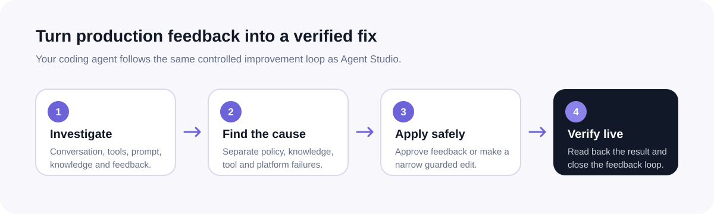

<p align="center">
  <a href="https://www.getadelante.com/">
    
  </a>
</p>

<h1 align="center">Manage your live support agent from Codex, Claude Code, or Cursor</h1>

<p align="center">
  Investigate support conversations, fix prompt and knowledge problems,<br>
  and check the result in Agent Studio.
</p>

<p align="center">
  <a href="https://www.getadelante.com/agent-platform"><strong>Explore Agent Studio</strong></a>
  ·
  <a href="https://www.getadelante.com/quiz"><strong>Get your AI agent</strong></a>
  ·
  <a href="https://github.com/tam1r/agent-skills/releases"><strong>Releases</strong></a>
</p>

<p align="center">
  <a href="https://skills.sh/tam1r/agent-skills"></a>
  <a href="https://github.com/tam1r/agent-skills/releases"></a>
  <a href="LICENSE"></a>
</p>

---

## Adelante Agent Studio Analyst

The Analyst skill teaches your coding agent how to work safely in Adelante Agent Studio. It reads
the customer conversation, prompt, knowledge, assigned-tool contracts, and feedback before it
changes anything. When the cause is clear, it applies the smallest authorized fix and reads the
live configuration again to make sure the change stuck.

<p align="center">
  
</p>

### What you can do

| Use case | What your coding agent does |
|---|---|
| Investigate a ticket | Reconstructs the conversation, tool calls, retrieved knowledge, prompt rules, and feedback |
| Triage feedback | Groups recurring issues, separates root causes, and identifies the smallest safe fix |
| Improve knowledge | Updates a scoped internal snippet or directs you to the authoritative URL source |
| Improve behavior | Applies a guarded prompt change only when a broad behavioral rule is necessary |
| Audit your agent | Finds contradictions across prompt, knowledge, and available assigned-tool contracts |
| Report outcomes | Analyzes support volume, handovers, resolution patterns, and attributed revenue |

## CX Review Loop

The `cx-review-loop` skill runs the recurring improvement routine for one support agent in your
team's chat. It builds on the Analyst skill.

| Routine | What it does |
|---|---|
| Weekly handover review | Compares last week's automation rate with the four weeks before, adds health lines (satisfaction, time to a person, spikes, incidents), reads every bot handover and what your team did next, sorts each by why the bot handed over, and proposes the knowledge or wording changes that would let the bot handle them |
| Daily feedback follow-up | Lists the feedback items still open and asks what to do with each |

Every proposal shows the exact text that would change. Nothing is applied until someone in the
team chat approves it, and each applied change is read back and confirmed.

```bash
npx skills add tam1r/agent-skills \
  --skill adelante-agent-studio-analyst \
  --skill cx-review-loop \
  -g -y
```

## CX Director Review

The `cx-director-review` skill prepares the decision brief for whoever runs customer
experience. It builds on the Analyst skill and reads the CX Review Loop's log, including its
weekly health lines.

| Cadence | What it does |
|---|---|
| Monthly review | Scorecard, voice of the customer, top recommendations, policy recommendations with pilots, prevent / automate / keep human per contact reason, asks for each owning team, quality, knowledge health, revenue, goodwill, readiness for upcoming changes, risks, and last month's decisions |
| Quarterly review | Targets, capacity and staffing, segments compared, cost and value of support, and a one-page executive summary |

It recommends and never changes the agent or any setting. Every number carries its period and
says whether it is measured or estimated.

```bash
npx skills add tam1r/agent-skills \
  --skill adelante-agent-studio-analyst \
  --skill cx-director-review \
  -g -y
```

## Install

Install the skill globally and let the Skills CLI detect your coding agents:

```bash
npx skills add tam1r/agent-skills \
  --skill adelante-agent-studio-analyst \
  -g -y
```

Or target one coding agent explicitly:

```bash
npx skills add tam1r/agent-skills \
  --skill adelante-agent-studio-analyst \
  --agent codex \
  -g -y
```

Replace `codex` with `claude-code`, `cursor`, or another agent supported by the
[Skills CLI](https://github.com/vercel-labs/skills).

## Connect Agent Studio

The skill includes the MCP setup instructions. Adelante gives each customer a scoped Agent Studio
API key. Keep it out of git and load it from an environment variable.

Once connected, start with:

> Show me the production agents I can access and summarize their pending feedback. Do not change
> anything yet.

Then ask:

> Investigate ticket 96728. Reconstruct what happened, inspect the prompt, retrieved knowledge,
> and tool results, then identify the root cause. Do not make changes.

## Stay up to date

```bash
npx skills update -g adelante-agent-studio-analyst -y
```

Installed copies are not updated automatically. Run this when Adelante announces a new version or
add it to your coding-agent startup workflow.

## Want an AI support agent for your business?

[Adelante](https://www.getadelante.com/) builds, launches, and continuously improves AI support
agents that answer customers, use approved tools, complete support work, and hand off with context.

**[Get your AI agent →](https://www.getadelante.com/quiz)**

---

<p align="center">
  <a href="https://www.getadelante.com/">Website</a>
  ·
  <a href="https://www.getadelante.com/agent-platform">Agent Studio</a>
  ·
  <a href="mailto:help@getadelante.com">Support</a>
</p>
